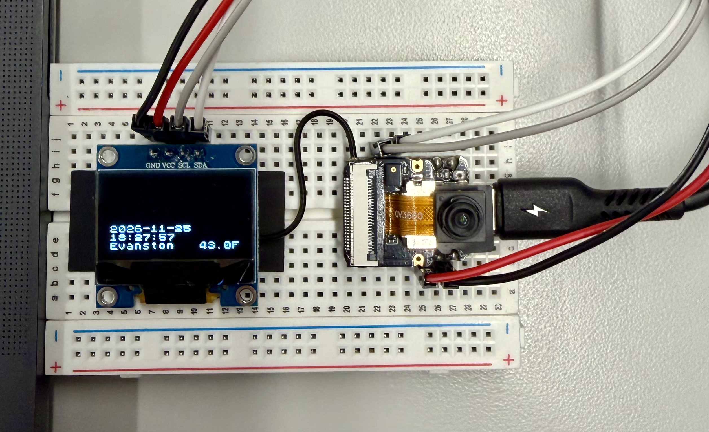

# ESP32-S3 Smartwatch

## Overview

I built an ESP32-S3 smartwatch prototype using Arduino C++ that integrates edge AI for camera-based hand gesture recognition, capacitive touch controls, voice recording, and a local web interface. The firmware uses a finite state machine to manage microphone input, external RAM storage, and OLED display operations. The device also supports Wi-Fi and Bluetooth Low Energy (BLE) connectivity, with a dedicated networking task handling Wi-Fi communication.

  

## Key Features

- **Edge AI:** Uses TensorFlow Lite Micro to run an INT8-quantized machine learning model directly on the ESP32-S3. Camera frames are preprocessed into 64 × 64 grayscale images before inference. To unlock the voice recording controls, the model must recognize a V-sign hand gesture in three consecutive inference cycles, each with a confidence score above 65%.
- **Audio Recording:** Captures 16-bit audio at a sampling rate of 16 kHz using a PDM microphone. Audio samples are stored in external PSRAM to conserve the microcontroller's internal RAM. The firmware reuses audio buffers to avoid repeated memory allocation and encodes recordings in PCM WAV format for playback and download. Each recording can last up to 10 seconds.
- **Wi-Fi Audio Access:** Hosts a local HTTP web interface on the ESP32-S3 so users can play and download WAV recordings from a phone or computer on the same Wi-Fi network. The firmware checks the watch’s operating state before granting access to recordings and prevents recordings from being replaced during a transfer.
- **Network Services:** Uses Wi-Fi to synchronize the smartwatch's clock through Network Time Protocol (NTP) and retrieve local weather information over HTTPS. The firmware verifies server certificates and validates weather responses before displaying the temperature on the OLED screen.
- **Capacitive Touch Input:** Allows users to start and stop voice recording through touch controls. The firmware calibrates the sensor at startup, periodically samples its readings, and uses debouncing to filter brief fluctuations so each touch is registered only once.

 

**Note:** The trained ML model is not included in this repository. The image preprocessing pipeline, TensorFlow Lite Micro inference integration, and gesture recognition logic are provided.
